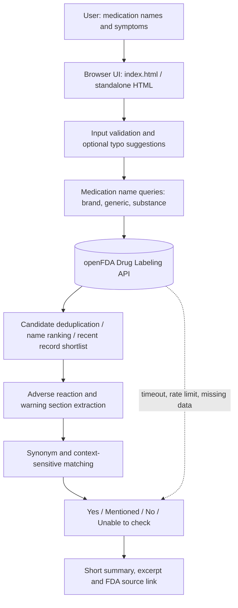
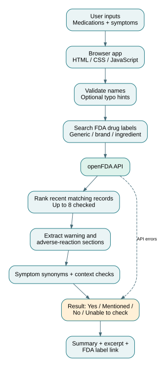

# MedSymp — Architecture

MedSymp is a static browser application. HTML defines the UI, CSS provides styling, and JavaScript handles local input validation and FDA requests. There is no application database or server of our own.

## Execution and data flow

1. `index.html` references `style.css`, `script.js` and local images. The separate `double-click-version/Open MedSymp.html` bundles styles and script into a single HTML file.
2. Input remains in the browser while the page is open. Search text is sent directly to the FDA API.
3. `searchDrug()` requests several matching label sets and uses `suitableRecord()` to shortlist records.
4. `matchSections()` examines retrieved label sections using `termsFor()`, basic negation and risk/context checks.
5. `renderResults()` presents small grouped result rows and source links; `sourceLink()` creates URLs to FDA-hosted structured records.

## Important boundaries

The openFDA API is a **data source, not a clinical reasoning engine**. Symptom matching is heuristic. Because lookup is limited to a recent candidate shortlist, an absent match cannot rule out an adverse effect. Hosting on GitHub Pages serves static files, not a backend.

### FDA PDF source links

The display retrieves approved-label PDF URLs from the separate Drugs@FDA API by application number, when available. Results are based on FDA-submitted structured labels and may not exactly correspond to the FDA-approved PDF. Missing PDF links fall back to the FDA Drugs@FDA official search page.

### Latest-label coverage (November 2026)
The application paginates openFDA search matches and groups versions by `set_id`, retaining the newest `effective_time` per label lineage. It no longer stops at eight records. API pagination limits, connectivity failures, and a 38-second per-medication time budget can make a search incomplete; in that case, a negative result is shown as **Unable to check**, not definitive **No**. This is not an authoritative guarantee of all FDA-approved product labeling.

### Product classification layer (update)

Input → FDA label pagination → latest revision per SET ID → product identity classification (ingredient, route, dosage form, brand) → symptom evidence matching → compact per-symptom display → validated FDA application-PDF URL or exact structured FDA label.

No results are returned for ambiguous non-equivalent formulations until the user enters a more specific product. Evidence from excluded combination products is not merged with single-ingredient generic label results.

### PDF versus structured data

The app links directly to an FDA-hosted prescribing-information PDF **only when** the Drugs@FDA API returns a document URL under an FDA domain for the corresponding application. Otherwise it explicitly offers **FDA label data (JSON)**. That structured data is not a formatted PDF. Application-level prescribing information may not be identical to the specific SPL record used for the symptom result.

## SPL/XML fallback
openFDA search → (if no usable label) DailyMed current SPL discovery by drug name → download latest SPL XML by SET ID → parse direct safety sections (adverse reactions, warnings, interactions) → existing symptom matcher → concise evidence results. Browser CORS limits may block XML retrieval from local files; errors remain explicit.

## SPL browser limitation and optional relay

Direct browser access to the DailyMed SPL/XML endpoint can fail due to CORS, especially from the double-click `file://` version. A static website cannot change that policy. To enable the SPL fallback, deploy the read-only Cloudflare Worker in [`worker/`](worker/) and set `SPL_RELAY_BASE` in the JavaScript (and standalone HTML). This requires a separately hosted service. The worker validates SET IDs, restricts the upstream host, and does not store medication or symptom inputs. Without it, display an explicit retrieval limitation rather than a misleading No.

Current revision: a server-side FDA application verification endpoint (`/api/approval`) supplements browser lookup in deployed versions. Matching words are highlighted in red using safe text nodes.
